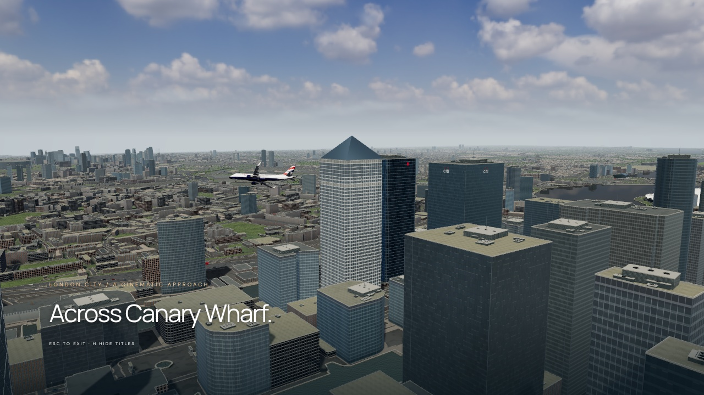

# Visual review — 5 November 2026

This pass was reviewed with fixed camera screenshots of the O2, One Canada Square, the west approach and the runway. The photographs are references, not textures projected over the scene.

| Area | Reference and visible correction |
| --- | --- |
| O2 | [Wikimedia aerial photograph](https://commons.wikimedia.org/wiki/File:O2_Arena_(9499773307).jpg): replaced the scaled hemisphere and thin poles with a shallow membrane, scalloped perimeter, panel seams, twelve outward-raked lattice masts, cable network, roof walk and cylindrical service structures. [Rendered view](../public/screenshots/o2.png). |
| Thames crossings | OSM tags identified the Blackwall and Silvertown tunnels. Underground roads were incorrectly appearing as bridges. Removed 198 core road ways and 2,004 context sections using the original tunnel metadata. |
| One Canada Square | [Wikimedia photograph](https://commons.wikimedia.org/wiki/File:London_MMB_S6_Canary_Wharf.jpg): pale window bays, different upper-floor glazing, a roof collar and a crown seated on the tower. Reduced the heavy horizontal roof striping. [Rendered view](../public/screenshots/one-canada-square.png). |
| Shard and City | [Shard photograph](https://commons.wikimedia.org/wiki/File:The_Shard_at_sunset_2017_(cropped).jpg) and [Gherkin / Leadenhall photograph](https://commons.wikimedia.org/wiki/File:Cheesegrater_and_Gherkin.jpg): faceted taper and split crown, curved spiral glazing, and the Leadenhall frame. [Shard render](../public/screenshots/shard.jpg), [City render](../public/screenshots/city.jpg). Surrounding generic building massing remains less detailed than these references. |
| City Hall and Newham council | Separate models for the [Crystal](../public/screenshots/city-hall.png) and [Dockside offices](../public/screenshots/newham-dockside.png), with folded dark glazing versus stone piers and horizontal sunshades. |
| Airfield | [Rendered apron](../public/screenshots/airfield.png): photographed concrete/asphalt/grass, terminal glazing, roof seams and gate guidance. Terminal massing and apron detail remain approximate. |
| Other architecture | Roof equipment varies in placement and size; surface finishes vary between membrane and gravel. Photographed brick and authored ambientCG masonry maps combine with metric curtain-wall shaders. Per-building layouts, glazing, metal frames and blinds vary the result; a static Canary Wharf cube probe supplies city reflections. Generic trim grids that conflicted with the texture spacing were removed. Surrounding districts also retain different facade families. |
| Ground and water | Mapped streets, parks and water boundaries; quays, cars, buses and streetlights; pedestrian paving. Small water-wave detail fades at distance, and warm diffuse light no longer turns the Thames into a brown mirror. |
| Daylight | CC0 HDR sky supplies image-based lighting; the visible sky blends into the same horizon haze as the scenery. Scene-linear grading, SMAA and hardware multisampling reduce edge aliasing. |

The wider city still uses simplified OSM extrusions and estimated heights where tags are missing. It is not photogrammetric scenery. The O2 is a reference-based architectural approximation. Fine lattice elements intentionally do not cast sub-pixel shadow-map shadows, which caused sparkle on the canopy.

## Verification

- Seventeen unit tests passed for wall/roof normals, swept building collision, flight, touchdown, braking, stronger bank authority and custom-start coordinate/heading conversion.
- Browser checks passed for both approaches, touchdown, braking, crash/retry, demo, mobile controls, loading gates and load-failure retry after the HDR/postprocessing pass.
- A clearance check of 400 sampled banked-tour positions found no intersections with the shipped building collision bounds.
- The capture script rejects browser/console errors and records the actual scene at deterministic simulation times, including the O2 shot.
- `scripts/check-revision.mjs` passed: four cardinal camera headings on both runways, flight outside the old boundary, building impacts and restart cleanup. It also captured 48 camera-turn frames.
- `scripts/check-custom-start.mjs` passed on desktop and mobile: map placement, unsafe spawn prevention, selected compass heading and altitude, runway 27, steep bank, exact-start retry and reset to standard mode. Screenshots are in the repository gallery.

The offline MP4 is demonstration media, not a real-time frame-rate measurement. Hardware uses multisampling; detected software renderers use a cheaper normal-play configuration. Capture explicitly requests full quality.

Sources, asset licenses and reconstruction scripts are in [SOURCES.md](SOURCES.md).

## Latest revision

The earlier review images were still visibly procedural: repeated high-contrast facade grids, bare flat roofs, inadequate vegetation in the western districts, and oversimplified landmark glazing. This revision adds view-space contact shading from the existing render depth, reduces facade contrast, adds mechanical roof structures across the City as well as Canary Wharf, and separates membrane/gravel roof finishes. Contact occlusion is calculated at half resolution and combined using depth-aware weights to preserve aircraft and roof edges. The contact pass respects reversed depth and skips the logarithmic-depth fallback.

The Gherkin now has a smooth curved profile and continuous spiral glazing. Dedicated curtain-wall materials remove the pillow-like normal-map distortion from the Shard and other bespoke glass towers. City Hall / the Crystal and Newham Dockside are separate models; both are included. Park-boundary vegetation now extends beyond the original eastern land-cover mask. The airport has neutral photographed concrete, metre-scale asphalt/grass, curtain-wall terminal glazing, roof seams and a taxi route to stand 4.

Gameplay checks cover continued taxiing after touchdown on both runways, parking at the gate, the centered and offset cameras, moving road traffic, boundary fog and session termination. The tour uses banked turns around the Shard, City, Eye, Canary Wharf and O2 before returning to the runway. These are staged demonstration paths, not measured real-world flight procedures.

The overall scenery remains an approximation. Generic OSM buildings still lack surveyed facade identities and some detailed massing; the screenshots should not be described as photographic or as matching the reference photographs.

The final landing review caught false horizontal occlusion bands on shallow ground. Depth reconstruction now snaps to the sampled depth texel centres, uses floating-point reversed depth and limits contact shading to six metres. A disabled-occlusion control frame confirmed the cause; the corrected landing sequence was recaptured. A negative first RAF delta could also select an invalid cinematic shot during loading; frame deltas and the tour clock are now clamped, with a regression test across all cuts and loops.

Apron slabs and the grass island previously shared a top height, producing coplanar flicker at shallow approach angles. Paved layers now have separate heights; procedural tyre and mowing detail also fades with pixel footprint. `scripts/review-landmarks.mjs` refreshes the fixed landmark/airfield views and checks the renderer after a portrait resize.

## District material and residential pass — 5 November

The fixed Canary Wharf camera exposed repeated white facade grids. Generic glass towers now use analytically filtered metric panes, metal mullions, floor spandrels and occasional crown louvres. Glazing and roughness vary by building and pane, with restrained blinds and panel bowing; district cube probes supply reflections. The shader follows the filtered-pulse approach in Slop New York, whose MIT license is retained. An initial overly blue version was rejected during screenshot review and the final palette uses quieter neutral, charcoal and green-grey glass.

Residential walls now use photographed brick with separately shaded windows. The context database grows from 81,150 to 98,936 outlines by preserving small western footprints and their residential treatment. Long regular terraces receive pitched roofs; irregular footprints retain flat roofs to avoid roofs protruding far beyond their walls. The context residential classification is inferred from building height, not surveyed roof data. All 62,528 existing tunnel-filtered road sections remain byte-for-byte equivalent as parsed data.

The refreshed [Canary Wharf](../public/screenshots/skyline.jpg) and [City](../public/screenshots/city.jpg) views use the same camera poses as the previous review. A separate [10-second banked district flythrough](../public/district-flythrough.mp4) shows this pass; the older full tour is retained and labelled separately. Seventeen unit tests pass, including roof winding/collision height and complete facade bay alignment. The landmark/airfield gallery and portrait resize render without browser errors.

The improvements do not make the city photorealistic. Generic tower massing, roof silhouettes, street furniture and incomplete source heights still limit the match to the reference photographs.

A lower [residential review view](../public/screenshots/residential.jpg) exposed the old land-cover raster boundary: much of western London was falling back to uniform paving. The EOX source now covers the entire flight area, and terrain and tree placement share explicit bounds. Its vegetation and broad brightness channels guide the close-range photographic ground materials. Grass is less saturated and courtyard paving is darker. Cars, buses, lamps and quays also extend across the western mapped roads; the browser check now verifies that western traffic moves.

### Fixed-camera comparison

| Previous material pass | Current material pass |
| --- | --- |
|  |  |

Both views use tour time 26 seconds. The surrounding towers no longer share the conspicuous white facade grid. The current pass has quieter metal frames, distinct spandrels and glazing, and stronger contrast between One Canada Square's pale piers and windows. Generic tower volumes and roof detail still need further architectural work.

The new district clip checks all 240 sampled aircraft positions against the current building collision bounds before recording. The browser interaction check passes centered/offset camera choices, touchdown-to-taxi on both runways, gate parking, boundary fog and retry, and moving traffic in both eastern and western districts. No production deployment was made.

The City reference comparison also exposed overly pale Gherkin glass and a structural grid too fine to read at flight distance. Its material now separates the primary silver diagrid from smaller glazing bars, uses broader and more steeply winding dark ventilation spirals, and reflects the City probe. [Gherkin detail](../public/screenshots/gherkin.jpg).

The expanded street system contains 13,673 moving vehicles in ten instanced draw groups including street furniture. Reusing each vehicle's rotation basis reduced the isolated traffic-update benchmark from 11.45 to 5.30 ms/frame in this container. All part matrices matched the previous implementation through five time steps including road turns (maximum numerical difference below 2e-15). This is a CPU-update microbenchmark, not a browser frame-rate claim.
